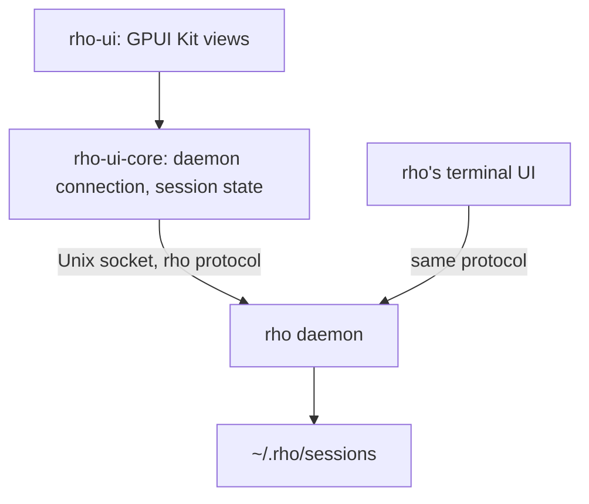

# rho-ui

The desktop app for [rho](https://github.com/matthewyjiang/rho), built with [GPUI Kit](https://gpui-kit.com).

rho-ui is a frontend of the rho daemon, like rho's terminal UI. It connects to the daemon's socket and speaks rho's own protocol through the [`rho-protocol`](https://crates.io/crates/rho-protocol) crate. It needs rho 3 or later: rho 2 has no daemon.

Sessions and their turns run in the daemon, so they outlive the app. A turn that rho-ui starts keeps running after the window closes, and a turn that the terminal UI started shows in rho-ui's sidebar, where you can open it, answer its approvals, and steer it.

## Run

```bash
cargo run -p rho-ui -- [DIR] [--rho PROGRAM]
```

`DIR` is where new sessions start; it defaults to the current directory. `PROGRAM` is the `rho` that starts the daemon when none runs; it defaults to `rho` on `PATH`. Which daemon rho-ui reaches follows from its own `RHO_HOME` (or `HOME`), so a `PROGRAM` that sets another `RHO_HOME` does not move it.

rho-ui connects to the daemon of the rho home (`$RHO_HOME`, or `~/.rho`) through `rho-protocol`'s `LocalDaemon`, which finds its socket the way rho does. When none runs, `LocalDaemon` starts it with `PROGRAM daemon start`, rho's own ensure-running path. The daemon belongs to the rho home, not to rho-ui, and keeps running after the app quits. Stop it with `rho daemon stop`.

On Linux you need a Wayland or X11 session with a working Vulkan driver. See the GPUI Kit [installation guide](https://gpui-kit.com/docs/installation/) for the system packages. The daemon's socket is a Unix socket, so rho-ui does not build on Windows yet.

## Layout



| Crate | Owns |
| --- | --- |
| `rho-ui-core` | The connection to the daemon, its requests, the event stream, `Session`, which turns session events into transcript entries, open requests and settings, and `Timeline`, which groups each run of tool calls and thoughts into one row and splits rows into turns, so the UI can fold a finished turn's working behind one line. It has no GUI code. It keeps one small Tokio runtime for the socket, because `rho-protocol`'s client needs one; every method returns a plain future that any executor can await. |
| `rho-ui` | Windows, views, and input. |

The workspace uses `rho-protocol` 1.0.0 from crates.io, the release that ships with rho 3.0.0. At the handshake the client names its wire schema; a daemon built against another schema still connects, and rho-ui shows the daemon's notice that requests may fail, so run a rho whose `rho-protocol` matches.

The composer's footer holds the session's settings: the permission mode (which tool calls run without asking) on the left, and on the right one button naming the model and reasoning, which opens the model list with search beside the reasoning levels and fast mode. New session opens the session right away, so these can be set before the first message; rho writes no file for a session until its first prompt, and the daemon discards an unused draft's session, so nothing is left behind. A setting changed while a turn runs applies when the turn ends.

A new session (Ctrl+N) starts in the project of the session on screen, else where the last new session started, else `DIR`. Above the draft's composer, "Start a session in" lists every folder rho has sessions in, the most recently used first, then `DIR` and any other folder used this run, with the draft's checked; click one to move the draft there. Ctrl+Shift+N starts a session with the keyboard in the list's search. Search by name or path, type an absolute or `~/` path to use any folder, or choose Open folder… for the desktop's folder chooser. A session's directory is fixed once it opens, so moving the draft lets its session go and opens another in the new folder: the composer's text stays, and the settings start over from the new session's.

While a turn runs, Enter in the composer steers it: the text joins the turn's next model request. Until the model reads it, it waits above the composer, where you can take it back. A message the turn can't take (it waits on an approval, or the daemon had just begun a turn of its own) waits above the composer too, and goes as the next prompt once the turn ends.

Background work a session's turns started (processes, workflow runs, subagents) is listed above the composer while it runs, with a button to stop each one. A turn ends while its background work runs on: rho-ui opens sessions with `idle_wake: turn`, so when the work finishes the daemon starts a turn of its own that gives the model the result, and rho-ui shows that turn like any other. Work that ended stays listed with how it ended (its exit status, or stopped) until the model has its result.

The sidebar lists the daemon's saved sessions. Once a second it also asks the daemon which sessions have work under way, so a session that runs a turn or waits for an approval shows as working or waiting whichever client started it.

Settling and snoozing sessions is rho-ui's own idea; rho has no such state. Sessions started or continued in rho-ui list as active. Sessions from elsewhere, such as rho's terminal UI, start out settled, so the sidebar doesn't fill with old history; a session with work under way always lists as active, and snoozing, restoring, prompting, or steering one makes it rho-ui's. rho-ui keeps this in `$XDG_STATE_HOME/rho-ui/shelves` (by default `~/.local/state/rho-ui/shelves`). A settled session comes back when it has new activity in rho-ui, and a snoozed one when its time is up. Snoozed and Settled sit under the active sessions, folded; open one to see its sessions on one line each, and hover a session for its details.

Settings (Ctrl+, or the gear at the bottom of the sidebar) open in a dialog over the window and hold the theme, the UI scale, the UI font (default Noto Sans) and the code font (default JetBrainsMono Nerd Font), saved in `$XDG_CONFIG_HOME/rho-ui/settings`. The theme is dark by default, or light, or whichever the desktop uses (System), following it as it changes. System isn't the default because on Linux rho-ui starts before the desktop portal reports light or dark, so a dark desktop would see a light first frame, and a desktop with no portal would stay light. Both themes are rho-ui's own, in `crates/rho-ui/themes/rho-ui.json` (GPUI Kit's theme format), in place of Kit's stock ones.

Neither crate is published to crates.io.

## Test

```bash
cargo test
```

- `rho-ui-core` has a scripted daemon for tests (`fake_daemon`, behind the `test-support` feature): `rho-protocol`'s real server side on a real Unix socket, with no model or network. `tests/fixtures/bash_turn.jsonl` is a recorded turn from a real daemon.
- `rho-ui` UI tests (`crates/rho-ui/src/ui_tests.rs`) open the real app in an offscreen window, click and type through GPUI Kit's test helpers, and talk to the same fake daemon. They need a working Vulkan driver; Mesa lavapipe works without a GPU. Each run saves screenshots to `target/ui-shots/` for review.

To measure frame times with 300 saved sessions and a 100-turn transcript, run `cargo test -p rho-ui --release frame_times -- --ignored --nocapture`.

To check rho-ui against a real daemon and model, install rho 3, sign it in, and run the `live_daemon` test. It starts the daemon, runs a turn through an approval, and saves screenshots. A new rho home starts in `bypass`, which asks for no approvals, so set `permission_mode = "supervised"` under `[behavior]` in its `config.toml`:

```bash
RHO_UI_LIVE_RHO=/path/to/rho cargo test -p rho-ui live_daemon -- --ignored --nocapture
```

Set `RHO_UI_LIVE_ATTACH` to the ID of a session whose turn waits on an approval, such as one you started in rho's terminal UI, and the test also opens that session, answers the approval, and steers the turn. Give that turn a command that runs for several seconds, such as `sleep 8`, so the steer arrives while it runs. Use a `RHO_HOME` of its own to keep the run away from your sessions.

`live_background` checks background work the same way: a turn starts two background processes and ends while they run, one is stopped from the list, and the other exits by itself; each time the daemon's own turn tells the model, and the test sends a message during one of those turns. It takes a few minutes:

```bash
RHO_UI_LIVE_RHO=/path/to/rho cargo test -p rho-ui live_background -- --ignored --nocapture
```

`Cargo.lock` follows GPUI Kit 0.9.0's own lock file; its `test-support` feature does not resolve against newer versions of some shared crates.
