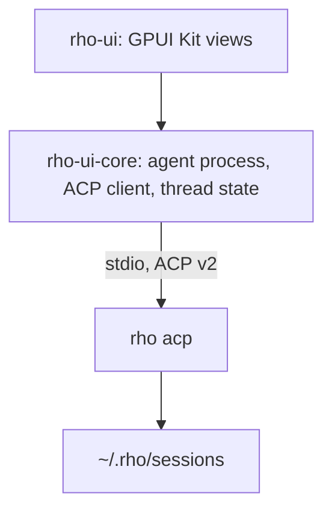

# rho-ui

The desktop app for [rho](https://github.com/matthewyjiang/rho), built with [GPUI Kit](https://gpui-kit.com).

rho-ui runs `rho acp` as a child process and talks to it over the [Agent Client Protocol](https://agentclientprotocol.com) (ACP), version 2. rho stays a separate binary. Any agent that speaks ACP v2 works too, and features ACP lacks get fixed in rho upstream first.

## Run

```bash
cargo run -p rho-ui -- [DIR] [-- AGENT COMMAND...]
```

`DIR` is where new threads start; it defaults to the current directory. The agent command defaults to `rho acp`. To pick a model for the whole process:

```bash
cargo run -p rho-ui -- ~/code/project -- rho --provider cliproxyapi --model anthropic/claude-haiku-5-5 acp
```

On Linux you need a Wayland or X11 session with a working Vulkan driver. See the GPUI Kit [installation guide](https://gpui-kit.com/docs/installation/) for the system packages.

## Layout



| Crate | Owns |
| --- | --- |
| `rho-ui-core` | Starting the agent, ACP requests, the event stream, `Thread`, which turns `session/update` notifications into transcript entries, and `Timeline`, which groups each run of tool calls and thoughts into one row and splits rows into turns, so the UI can fold a finished turn's working behind one line. It has no GUI code and no async runtime: the caller drives the connection on its own executor, so a future daemon can reuse it unchanged. |
| `rho-ui` | Windows, views, and input. |

The composer's footer holds the session settings rho offers over ACP: the mode (which tool calls run without asking) on the left, and on the right one button naming the model and reasoning, which opens the model list with search beside the reasoning levels and fast mode. A New thread opens its session right away, so these can be set before the first message; rho writes no file for a session until its first prompt, and an unused draft closes its session, so nothing is left behind.

One `rho acp` process serves every thread; rho keeps sessions in a map, and a new session in a warm process takes about 20 ms. Sessions live in `~/.rho/sessions`, so they show up in the TUI and other ACP hosts as well.

Settling and snoozing threads is rho-ui's own idea; rho has no such state. Threads started or continued in rho-ui list as active. Threads from elsewhere, such as rho's terminal UI, start out settled, so the sidebar doesn't fill with old history; snoozing or restoring one makes it rho-ui's. rho-ui keeps this in `$XDG_STATE_HOME/rho-ui/shelves` (by default `~/.local/state/rho-ui/shelves`). A settled thread comes back when it has new activity in rho-ui, and a snoozed one when its time is up. Snoozed and Settled sit under the active threads, folded; open one to see its threads on one line each, and hover a thread for its details.

Settings (Ctrl+, or the gear at the bottom of the sidebar) hold the UI scale, the UI font (default Noto Sans) and the code font (default JetBrainsMono Nerd Font), saved in `$XDG_CONFIG_HOME/rho-ui/settings`.

Neither crate is published to crates.io.

## Test

```bash
cargo test
```

- `rho-ui-core` tests run `crates/rho-ui-core/tests/fake_agent.py`, a scripted ACP agent, so they need `python3` but no model or network. `tests/fixtures/bash_turn.jsonl` is a recorded turn from a real `rho acp`.
- `rho-ui` UI tests (`crates/rho-ui/src/ui_tests.rs`) open the real app in an offscreen window, click and type through GPUI Kit's test helpers, and talk to the same fake agent. They need a working Vulkan driver; Mesa lavapipe works without a GPU. Each run saves screenshots to `target/ui-shots/` for review.

To measure frame times with 300 saved threads and a 100-turn transcript, run `cargo test -p rho-ui --release frame_times -- --ignored --nocapture`.

`Cargo.lock` follows GPUI Kit 0.9.0's own lock file; its `test-support` feature does not resolve against newer versions of some shared crates.
