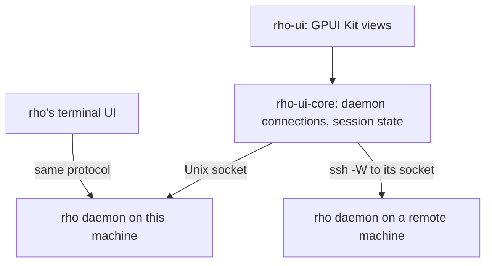

# Architecture

rho-ui is a frontend of the rho daemon, like rho's terminal UI. It connects to the daemon of each machine you set up, this one and any remote ones, and speaks rho's own protocol through the [`rho-protocol`](https://crates.io/crates/rho-protocol) crate.

| Crate | Owns |
| --- | --- |
| `rho-ui-core` | The connection to the daemon, its requests, the event stream, `Session`, which turns session events into transcript entries (each tool call keeps the daemon's `ToolCard`, what to show a person, beside the content the model read), open requests and settings, `AgentSettings`, rho's own settings as the daemon describes them (`rho/config/schema`), with their values (`rho/config/get`) kept current by `DaemonEvent::AgentSettingsChanged` and written back with `Daemon::set_agent_settings`, and `Timeline`, which groups each run of tool calls and thoughts into one row and splits rows into turns, so the UI can fold a finished turn's working behind one line. It has no GUI code. It keeps one small Tokio runtime for the socket, because `rho-protocol`'s client needs one; every method returns a plain future that any executor can await. |
| `rho-ui` | Windows, views, and input, and which machine each session, project and folder is on. `RhoApp` keeps one connection per machine; `machines.rs` names machines and keys sessions (`SessionKey`) and folders (`Place`) by machine, since session IDs are unique only within one daemon. `rho_settings.rs` reads each connected machine's rho settings for the Settings dialog, and sends one write at a time to each. |

The workspace uses `rho-protocol` 1.0.0 from crates.io, the release that ships with rho 3.0.0. At the handshake the client names its wire schema; a daemon built against another schema still connects, and rho-ui shows the daemon's notice that requests may fail, so run a rho whose `rho-protocol` matches.

## Daemon connections

rho-ui connects to this machine's daemon and to the daemon of each remote machine in its [settings](features.md#machines), each on its own connection. One machine's connection failing or closing leaves the others alone; the sidebar says which machine is unreachable and offers Retry.

Which daemon rho-ui reaches on this machine follows from its own `RHO_HOME` (or `HOME`), so a `--rho PROGRAM` that sets another `RHO_HOME` does not move it.

rho-ui connects to the daemon of the rho home (`$RHO_HOME`, or `~/.rho`) through `rho-protocol`'s `LocalDaemon`, which finds its socket the way rho does. When none runs, `LocalDaemon` starts it with `PROGRAM daemon start`, rho's own ensure-running path. The daemon belongs to the rho home, not to rho-ui, and keeps running after the app quits. Stop it with `rho daemon stop`.

A daemon on another machine is a `DaemonTarget::Ssh` (`ssh.rs`). rho-ui opens one ssh master connection per host and sends every later ssh call through it, so the user's key agent asks for approval once; the master stays up ten minutes after the last use. ssh runs with `BatchMode`, since the app has no terminal to type a password in: the host's key must be in `known_hosts`, and the user's key must sign without a prompt in the terminal, as from an agent such as 1Password's. Through it, a POSIX `sh` script runs `rho daemon start` on the host and prints the rho home, `XDG_RUNTIME_DIR`, `HOME`, and the login shell's environment. rho-ui finds the socket from those with `DaemonEndpoint::locate`, as `LocalDaemon` does here, and talks to it through `ssh -W`. Sessions on that daemon get the host's login environment, not rho-ui's, since rho runs a session with the environment its client sends. `DaemonInfo::home` gives the host's home directory for paths shown with `~`. The master sends keepalives every 15 seconds and quits after 3 go unanswered, so a dead link closes every `ssh -W` through it, and the app sees the connection end. The setup script must finish within 30 seconds. Each host gets its own lock around starting its master, so one waiting for approval doesn't hold up the others.

In rho-ui, `Machines` (`machines.rs`) is the one record of the machines the settings name: each one's label, its address, and how its connection is doing, which the sidebar footer, the project picker and the composer read. `RhoApp` keeps one `Connection` per machine, holding its daemon and tasks.

## State

rho-ui keeps the settings you choose in `$XDG_CONFIG_HOME/rho-ui/settings` (by default `~/.config/rho-ui/settings`), and what it remembers between runs in one SQLite database, `$XDG_STATE_HOME/rho-ui/state.sqlite3` (by default `~/.local/state/rho-ui/state.sqlite3`): your projects, settled and snoozed sessions, how long each turn took, the background work each session ran, whether the sidebar is collapsed, its filter, and whether the right panel shows, and how wide. Projects, shelved sessions and background work are kept by machine. `crates/rho-ui/src/store.rs` holds the schema and why it is shaped as it is. Each owner loads its rows at start and writes one row per change. rho-ui has no release, so a database of another schema version starts over empty rather than migrating. If rho-ui can't open the database, it says why on stderr and runs without remembering anything.

rho's own settings are not rho-ui's: they live in each machine's `config.toml`, which rho-ui reads and writes only through that machine's daemon. rho-ui's settings stay in its own file rather than in a daemon's (`rho/config/register` would let rho keep them): the theme, scale and fonts apply before the first frame, before any daemon has answered, and the machines list is how rho-ui reaches the remote daemons at all.

## Dependencies

The daemon's socket is a Unix socket, so rho-ui does not build on Windows yet.

Neither crate is published to crates.io.

The right panel's terminal links Ghostty's libghostty-vt 1.0.1 through the `libghostty-vt` crate, taken from git until its next release. Its build script clones Ghostty at the pinned commit and builds the library with Zig 0.17, which the repository's `mise.toml` installs; there is no prebuilt library for Linux. Set `GHOSTTY_SOURCE_DIR` to a Ghostty checkout to build without the network.

`crates/rho-ui/vendor/pele` holds [pele](https://github.com/obsidianmd/pele) 1.9.0's browser build (`dist/pele.global.js` from npm, MIT), which draws Mermaid diagrams in an embedded QuickJS. Update it by copying that file again; `pele`'s tests fail if the new build draws with a color the theme doesn't set.

`Cargo.lock` follows GPUI Kit 0.9.1's own lock file; its `test-support` feature does not resolve against newer versions of some shared crates. The one exception is `gpui-fast`: the published 0.9.1 asks for 0.1.15, newer than its lock file's 0.1.14.
