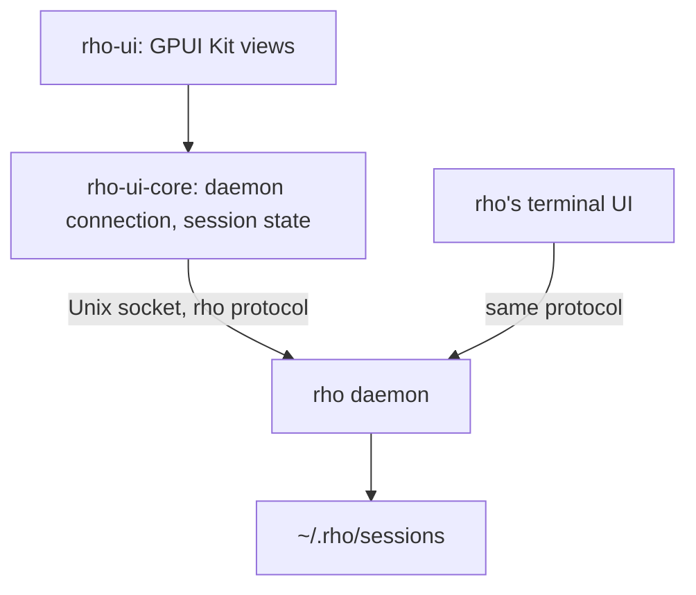

# Architecture

rho-ui is a frontend of the rho daemon, like rho's terminal UI. It connects to the daemon's socket and speaks rho's own protocol through the [`rho-protocol`](https://crates.io/crates/rho-protocol) crate.

| Crate | Owns |
| --- | --- |
| `rho-ui-core` | The connection to the daemon, its requests, the event stream, `Session`, which turns session events into transcript entries (each tool call keeps the daemon's `ToolCard`, what to show a person, beside the content the model read), open requests and settings, and `Timeline`, which groups each run of tool calls and thoughts into one row and splits rows into turns, so the UI can fold a finished turn's working behind one line. It has no GUI code. It keeps one small Tokio runtime for the socket, because `rho-protocol`'s client needs one; every method returns a plain future that any executor can await. |
| `rho-ui` | Windows, views, and input. |

The workspace uses `rho-protocol` 1.0.0 from crates.io, the release that ships with rho 3.0.0. At the handshake the client names its wire schema; a daemon built against another schema still connects, and rho-ui shows the daemon's notice that requests may fail, so run a rho whose `rho-protocol` matches.

## Daemon connection

Which daemon rho-ui reaches follows from its own `RHO_HOME` (or `HOME`), so a `--rho PROGRAM` that sets another `RHO_HOME` does not move it.

rho-ui connects to the daemon of the rho home (`$RHO_HOME`, or `~/.rho`) through `rho-protocol`'s `LocalDaemon`, which finds its socket the way rho does. When none runs, `LocalDaemon` starts it with `PROGRAM daemon start`, rho's own ensure-running path. The daemon belongs to the rho home, not to rho-ui, and keeps running after the app quits. Stop it with `rho daemon stop`.

## Dependencies

The daemon's socket is a Unix socket, so rho-ui does not build on Windows yet.

Neither crate is published to crates.io.

`Cargo.lock` follows GPUI Kit 0.9.0's own lock file; its `test-support` feature does not resolve against newer versions of some shared crates.
