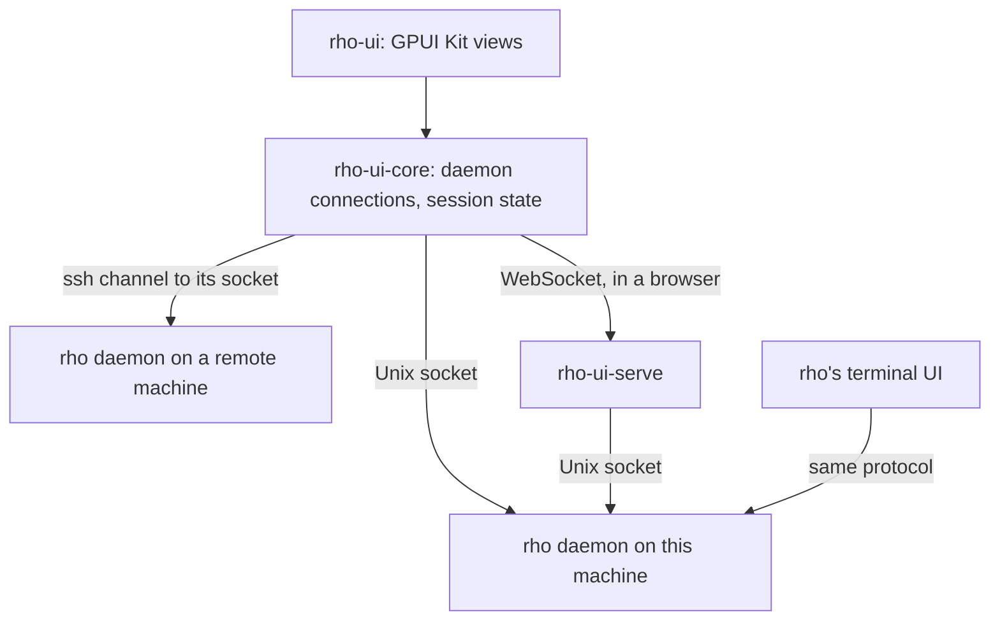

# Architecture

rho-ui is a frontend of the rho daemon, like rho's terminal UI. It connects to the daemon of each machine you set up, this one and any remote ones, and speaks rho's own protocol through the [`rho-protocol`](https://crates.io/crates/rho-protocol) crate.



| Crate | Owns |
| --- | --- |
| `rho-ui-core` | The connection to the daemon, its requests, the event stream, `Session`, which turns session events into transcript entries (each tool call keeps the daemon's `ToolCard`, what to show a person, beside the content the model read), open requests and settings, `AgentSettings`, rho's own settings as the daemon describes them (`rho/config/schema`), with their values (`rho/config/get`) kept current by `DaemonEvent::AgentSettingsChanged` and written back with `Daemon::set_agent_settings`, `Jobs` (`jobs.rs`), what one `rho/job/list` says: the sessions with work under way, and each session's subagent and workflow runs (`Runs`), nested as the jobs' parents say, a workflow's drives as one run, with their queue place and error, and `Timeline`, which groups each run of tool calls and thoughts into one row and splits rows into turns, so the UI can fold a finished turn's working behind one line. It also runs each machine's `rho` program apart from its daemon (`rho_install.rs`): whether rho is there, whether a newer release is out (`rho update --check --json`), and installing or updating it. On this machine it runs `rho` itself, and rho's own installer to install it: `install.sh` with `sh` on Unix, `install.ps1` with PowerShell on Windows. On a remote machine each job is one POSIX `sh` script over ssh. It has no GUI code. It keeps one small Tokio runtime for the daemon sockets and the ssh connections that carry remote ones, because `rho-protocol`'s client and russh need one; every method returns a plain future that any executor can await. |
| `rho-ui-serve` | Serves rho-ui's web build to a browser, and does on its machine what a browser can't: runs a script, relays the daemon's Unix socket, and runs the terminal's login shell, each over a WebSocket of its own (see [In a browser](#in-a-browser)). |
| `rho-ui` | Windows, views, and input, and which machine each session, project and folder is on. `RhoApp` keeps one connection per machine; `machines.rs` names machines and keys sessions (`SessionKey`) and folders (`Place`) by machine, since session IDs are unique only within one daemon. `rho_install.rs` keeps what each machine's rho needs, installing, updating, or a restart into the newer one its daemon waits to run, for the setup screen, the sidebar's footer and About. `rho_settings.rs` reads each connected machine's rho settings for the Settings dialog, and sends one write at a time to each. `auths.rs` keeps each connected machine's auth profiles, its credential store and the login it runs, for Settings → Providers and the sign-in card above a signed-out session's composer (`sign_in.rs`), which act through it alike. `forge.rs` checks the forge CLIs on each machine, such as GitHub's `gh`, and parses what they say of their accounts; like `folders.rs`, it runs them here as programs and on a remote machine with a POSIX `sh` script per job (`forge::Job`), both printing the same for one parser. `pull_requests.rs` reads the pull request of each session's branch, or the one linked to it (`PrLinks`, in the state database), through one of them: every 30 seconds for the session on the Pull request surface, and every 5 minutes for the sidebar's active rows, with one batched GraphQL query per machine, reader and host (`forge/gh_pulls.rs` builds and reads it). The PR data both sides share, what a query asks and what it finds, is in `pull_requests/model.rs`. |

The workspace uses `rho-protocol` 1.2.0 from crates.io, released with rho 3; 1.2 is the first that builds its client for the browser. At the handshake the client names its wire schema; a daemon built against another schema still connects, and rho-ui shows the daemon's notice that requests may fail, so run a rho whose `rho-protocol` matches.

## Daemon connections

rho-ui connects to this machine's daemon and to the daemon of each remote machine in its [settings](features.md#machines), each on its own connection. One machine's connection failing or closing leaves the others alone; the sidebar says which machine is unreachable and offers Retry.

Which daemon rho-ui reaches on this machine follows from its own `RHO_HOME` (or `HOME`), so a `--rho PROGRAM` that sets another `RHO_HOME` does not move it.

rho-ui connects to the daemon of the rho home (`$RHO_HOME`, or `~/.rho`) through `rho-protocol`'s `LocalDaemon`, which finds its socket the way rho does. When none runs, `LocalDaemon` starts it with `PROGRAM daemon start`, rho's own ensure-running path. The daemon belongs to the rho home, not to rho-ui, and keeps running after the app quits. Stop it with `rho daemon stop`.

A daemon on another machine is a `DaemonTarget::Ssh` (`ssh.rs`). rho-ui reaches it with an ssh client in its own process, [russh](https://crates.io/crates/russh), so it works the same from Linux, macOS and Windows. It opens one ssh connection per host (`ssh/connection.rs`) and keeps it while anything uses it (a `Daemon` or an `SshLink`) and the link stays up, then 10 minutes more, as the `ControlPersist 600` of the OpenSSH master it replaced did: the daemon's socket and every script there ride it, so the user's key agent asks for approval once, and a reconnect within those 10 minutes asks nothing. A machine removed in Settings lets its connection, and the login session on the host, go 10 minutes later. Callers for one host wait on one another while it opens, so they share it; other hosts don't wait. The connection follows the user's ssh config as `ssh -G HOST` resolves it (`ssh/config.rs`): `HostName`, `User`, `Port`, `IdentityFile` and `CertificateFile` (with their `%` tokens and `${VAR}`s, but `%i`: a file that uses it is skipped, and named if signing in fails), `IdentitiesOnly`, `IdentityAgent`, `UserKnownHostsFile`, `GlobalKnownHostsFile`, `HostKeyAlias` and `RevokedHostKeys`; without a local `ssh`, OpenSSH's defaults. A host reached through `ProxyCommand` or `ProxyJump` fails, naming the directive. The app has no terminal to type a password or accept a host key in, so it acts as OpenSSH does with `BatchMode` and `StrictHostKeyChecking yes`: the host's key must be in `known_hosts` (`ssh/host_key.rs`, which never writes the file) and not in the `RevokedHostKeys` file, which rho-ui reads as a text list of keys: one it can't read, such as a binary KRL, or that isn't there stops the connection rather than go unchecked, as OpenSSH refuses every host then. rho-ui checks plain host keys, not host certificates: a host that `known_hosts` vouches for only with an `@cert-authority` line is refused, and the error says why. It signs in with the key agent's keys and certificates, those of the configured files first, then with each key file that needs no passphrase and holds an Ed25519, ECDSA or RSA key (others, such as FIDO `sk-` keys, are skipped and named), offering its certificates (but an RSA key's, which russh would sign under a name sshd refuses) (`<file>-cert.pub` beside it, and any `CertificateFile` for its key) before the key itself; each key and certificate goes once (`ssh/auth.rs`). On Windows, without `SSH_AUTH_SOCK`, the agent is OpenSSH's, at its named pipe; Pageant isn't used. Every file this reads, and `ssh -G`'s program, is looked up on Tokio's blocking threads before connecting, so the runtime's one worker never waits on the disk. On it, a POSIX `sh` script runs `rho daemon start` on the host and prints `HOME`, `rho daemon status --json`, whose `socket` says where the daemon listens, and the login shell's environment (`setup.rs`, which any `Link` runs). rho-ui opens a `direct-streamlocal` channel to that socket, as `ssh -W` does, and speaks the protocol over it. Sessions on that daemon get the host's login environment, not rho-ui's, since rho runs a session with the environment its client sends. `DaemonInfo::home` gives the host's home directory for paths shown with `~`. The connection sends a keepalive after 15 quiet seconds and closes after 3 go unanswered, so a dead link closes the daemon's channel, and the app sees the connection end. Reaching the host, up to its key exchange, must take under 15 seconds; the setup script must finish within 30 seconds, and a daemon reached over its channel (or at a `DaemonTarget::Socket`) must answer the handshake within `HANDSHAKE_DEADLINE` (`daemon.rs`). Each script runs in a session channel of its own (`ssh/script.rs`), which closes when the script ends or its caller gives up. A connection attempt that is given up, as when the user retries, stops what it started; a connection that signed in stays for the next one, for 10 minutes. A script that sshd refuses to run fails at once. The Terminal surface's shell on a remote machine runs in a session channel of its own too, under a pseudo-terminal sshd makes (`ssh/shell.rs`, `SshLink::open_shell`; its module docs say what it asks sshd for, how its task carries output and input, and why the terminal must keep reading). Closing the terminal hangs up on the shell at once, and an open one keeps the machine's connection. The terminals' shells run on a second connection to the host (`connection::Purpose::Terminals`), opened by the first, reached as the daemon's was, and kept the same way, so scripts and shells never compete for sshd's sessions; it runs at most `MAX_SHELLS` shells at once, sshd's default `MaxSessions`, and one more doesn't start, and its pane names the limit. The right panel's terminal runs either kind of shell through one `Program` (`right_panel/terminal/program.rs`). A remote shell that can't start, or whose connection goes, shows why in its pane with Restart.

What rho-ui-core does on a machine it reaches through something, ssh or rho-ui-serve, goes through a `Link` (`link.rs`): run a script, run one that may take long, open the terminal's shell. The setup script, the scripts behind the Files and Diff surfaces, forge CLIs and rho's installer run through it the same either way.

In rho-ui, `Machines` (`machines.rs`) is the one record of the machines the settings name: each one's label, its address, and how its connection is doing, which the sidebar footer, the project picker and the composer read. `RhoApp` keeps one `Connection` per machine, holding its daemon and tasks.

## In a browser

rho-ui also builds for `wasm32-unknown-unknown`, on GPUI's web platform, which draws the window on a canvas with WebGPU, else WebGL2. A browser can't open a Unix socket or run a program, so rho-ui-serve, run natively on the machine, does that for it, and the page reaches that machine the way the desktop app reaches a remote one over ssh: a `DaemonTarget::Server` (`server.rs`) whose `ServerLink` opens one WebSocket per use, as ssh opens a channel. `server/wire.rs` lists the endpoints: `/script` runs `sh -s` in the home folder, `/socket?path=` relays a Unix socket, and `/shell` runs `$SHELL -l` under a pseudo-terminal. rho-ui-serve runs on Unix only. So the setup script, `rho-protocol`'s client and the terminal are the same code as over ssh, and the machine the browser shows as this machine is the server's.

```sh
scripts/build-web.sh          # into target/web; --dev for a quicker debug build
cargo run -p rho-ui-serve     # prints http://127.0.0.1:8765/#token=...
```

Whoever reaches rho-ui-serve can run anything as its user, so it listens on 127.0.0.1 and opens a WebSocket only for a page holding the token it prints (`auth.rs`). The printed URL carries the token in its fragment, `/#token=`, which a browser sends to no server; the page keeps it for the tab (`sessionStorage`), takes it out of the address, and offers it with each WebSocket as a subprotocol, which the server names back. A cookie would reach every other server on the host, as a browser sends one to every port. A WebSocket must also come from a page the server served (`Origin`). The page's files hold no secret and are served to anyone. Reach it from another machine through a tunnel, such as `ssh -L`.

The terminal's output comes at most `SHELL_WINDOW` (1 MiB) ahead of what the page took, as a browser can't hold back a WebSocket's reads: the page says what it took, and the server reads no more of the shell until it does.

The build script runs `wasm-bindgen` (pinned in `mise.toml` to the `wasm-bindgen` in `Cargo.lock`, which it must match), copies GPUI Kit's icons, which the page fetches as it draws each, and downloads the page's fonts, Noto Sans and JetBrains Mono, checked against their SHA-256, as a browser has no fonts GPUI can read. GPUI's web platform pulls in `wasm_thread`, which names a nightly feature even when unused, so the script lets that one crate build on stable with `RUSTC_BOOTSTRAP=wasm_thread`. Code that runs in both builds takes `Instant` and `SystemTime` from `web-time`, as std's panic in a browser.

What differs in a browser:

- There are no ssh machines: the server's machine is the only one.
- The state database is in memory, and settings aren't saved: nothing is remembered past the page.
- pele draws Mermaid diagrams as the page's own JavaScript (`pele/browser.rs`), which has no memory or time limit, unlike QuickJS's on the desktop.
- There is no desktop file chooser: adding a project on the server's machine browses from `~/` in the search, as on a remote machine, and the composer has no attach button.

## State

rho-ui keeps the settings you choose in `$XDG_CONFIG_HOME/rho-ui/settings` (by default `~/.config/rho-ui/settings`, on macOS too), and what it remembers between runs in one SQLite database, `$XDG_STATE_HOME/rho-ui/state.sqlite3` (by default `~/.local/state/rho-ui/state.sqlite3`): your projects, pinned, settled and snoozed sessions, how long each turn took, the background work each session ran, whether the sidebar is collapsed, its filter, and whether the right panel shows, and how wide. Projects, shelved sessions and background work are kept by machine. `crates/rho-ui/src/store.rs` holds the schema and why it is shaped as it is. Each owner loads its rows at start and writes one row per change. rho-ui has no release, so a database of another schema version starts over empty rather than migrating. If rho-ui can't open the database, it says why on stderr and runs without remembering anything.

rho's own settings are not rho-ui's: they live in each machine's `config.toml`, which rho-ui reads and writes only through that machine's daemon. rho-ui's settings stay in its own file rather than in a daemon's (`rho/config/register` would let rho keep them): the theme, scale and fonts apply before the first frame, before any daemon has answered, and the machines list is how rho-ui reaches the remote daemons at all.

## Dependencies

rho-ui runs on Linux and macOS. What differs between operating systems lives in `rho-ui-core`'s `platform` module: the home, settings and state folders, the folder rho's installer puts `rho` in, the default shell, how to run a program such as `git` in the background (on Windows, without a console window), how a path becomes bytes for the database or a remote shell, and how to reach a daemon's local endpoint. The rest of rho-ui asks it rather than reading variables or naming an OS itself. Besides it, `rho_install.rs` runs rho's installer for the OS, a `sh` script on Unix and a PowerShell one on Windows, and only the key bindings in `main.rs` branch on the OS where they are bound, as GPUI Kit's do: app shortcuts use `secondary-` (Cmd on macOS, Ctrl elsewhere), and the terminal's own keys, for the clipboard, tabs and splits, are Ghostty's defaults on each platform, which differ by more than the modifier. On macOS, `app_menu.rs` sets the menu bar; each item names an action, and GPUI takes its shortcut from the keymap and greys it out where nothing handles it.

What rho-ui does on this machine for the Files and Diff surfaces, pictures in messages, and cloning, it does with `git` run as a program (`local.rs`) and the files themselves, and it checks and updates rho by running `rho`, with no shell between. A remote machine, which is Unix, gets a POSIX `sh` script over ssh for each instead, parsed into the same value. `folders::Reader::query` picks between the two for each feature; the tests run each script against the same fixture as the Rust that reads this machine.

rho-ui doesn't run on Windows yet. Remote machines work from Windows, through the ssh client in rho-ui's own process. One thing blocks the rest: rho-protocol's `LocalDaemon`, which finds or starts this machine's daemon, is Unix-only until a rho-protocol release adds Windows (rho's PR #1972).

Neither crate is published to crates.io.

The ssh client is russh 0.65 with its `ring` crypto backend rather than its default, aws-lc-rs, which needs cmake and NASM to build on Windows.

The right panel's terminal links Ghostty's libghostty-vt 1.0.1 through the `libghostty-vt` crate, taken from git until its next release. Its build script clones Ghostty at the pinned commit and builds the library with Zig 0.17, which the repository's `mise.toml` installs; there is no prebuilt library for Linux. Set `GHOSTTY_SOURCE_DIR` to a Ghostty checkout to build without the network.

`crates/rho-ui/vendor/pele` holds [pele](https://github.com/obsidianmd/pele) 1.9.0's browser build (`dist/pele.global.js` from npm, MIT), which draws Mermaid diagrams in an embedded QuickJS, or in a browser as the page's JavaScript. Update it by copying that file again; `pele`'s tests fail if the new build draws with a color the theme doesn't set.

`Cargo.lock` follows GPUI Kit 0.9.1's own lock file; its `test-support` feature does not resolve against newer versions of some shared crates. The one exception is `gpui-fast`: the published 0.9.1 asks for 0.1.15, newer than its lock file's 0.1.14.
