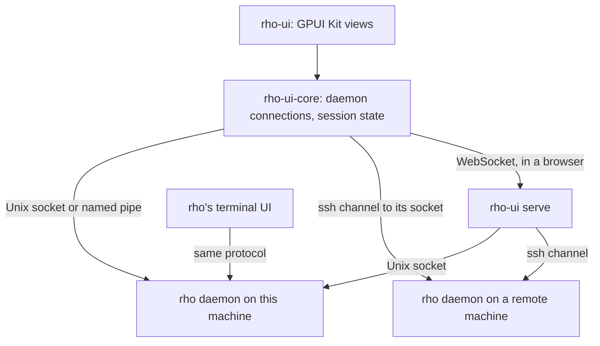
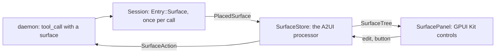

# Architecture

rho-ui is a frontend of the rho daemon, like rho's terminal UI. It connects to the daemon of each machine you set up, this one and any remote ones, and speaks rho's own protocol through the [`rho-protocol`](https://crates.io/crates/rho-protocol) crate.



| Crate | Owns |
| --- | --- |
| `rho-ui-core` | The connection to the daemon, its requests, the event stream, `Session`, which turns session events into transcript entries (each tool call keeps the daemon's `ToolCard`, what to show a person, beside the content the model read), open requests and settings, `AgentSettings`, rho's own settings as the daemon describes them (`rho/config/schema`), with their values (`rho/config/get`) and the models a model setting may take (`rho/model/list`), both kept current by `DaemonEvent::AgentSettingsChanged`, the values written back with `Daemon::set_agent_settings`, `sync`, settings sync between two machines: what differs between them by kind (rho's settings, the user's plugins, model aliases and favorites and provider profiles through `rho/config/table/*`, API keys and logins, MCP servers through `rho/mcp/config/*`, the user's hooks file through `rho/hooks/file/*`), what syncing the checked rows writes, part by part in an order where nothing names a provider the target lacks yet, and what Revert puts back, in the reverse order, as data a view draws without knowing the kinds; secrets go sealed from daemon to daemon (`rho/sync/*`), and the target's journal, not rho-ui, keeps what a sync replaced of them, `Jobs` (`jobs.rs`), what one `rho/job/list` says: the sessions with work under way, and each session's subagent and workflow runs (`Runs`), nested as the jobs' parents say, a workflow's drives as one run, with their queue place and error, and `Timeline`, which groups each run of tool calls and thoughts into one row and splits rows into turns, so the UI can fold a finished turn's working behind one line. `surface` holds the surfaces a session's `ui` tool shows (see [Surfaces](#surfaces)). It also has the client side of `rho-ui serve` (`server.rs`, see [In a browser](#in-a-browser)). It also runs each machine's `rho` program apart from its daemon (`rho_install.rs`): whether rho is there, whether a newer release is out (`rho update --check --json`), and installing or updating it. On this machine it runs `rho` itself, and rho's own installer to install it: `install.sh` with `sh` on Unix, `install.ps1` with PowerShell on Windows. On a remote machine each job is one POSIX `sh` script over ssh. It has no GUI code. It keeps one small Tokio runtime for the daemon sockets and the ssh connections that carry remote ones, because `rho-protocol`'s client and russh need one; every method returns a plain future that any executor can await. |
| `rho-a2ui` (crates.io) | rho's A2UI v1.0 core, released with rho and named `a2ui` in rho-ui's code. `rho-ui-core` uses its renderer side: `MessageProcessor`, which applies the daemon's surface messages, resolves a component's properties in a scope for a view and dispatches its actions, with the basic catalog (`Catalog::basic()`, `Functions::basic()`) and `DataModel`. It has no GUI code. Its source, and the Google conformance suites it is tested against, live in rho (`crates/rho-a2ui`). |
| `rho-ui` | Windows, views, and input, and which machine each session, project and folder is on. `RhoApp` keeps one connection per machine; `machines.rs` names machines and keys sessions (`SessionKey`) and folders (`Place`) by machine, since session IDs are unique only within one daemon. `Machines` also carries what the user asks of a machine's daemon (`DaemonAction`: connect again, restart, stop) from whichever view to `RhoApp`, whose `app/daemon_control.rs` asks first, saying what it would cut short, then acts. `rho_install.rs` keeps what each machine's rho needs, installing, updating, or a restart into the newer one its daemon waits to run, for the setup screen, the sidebar's footer and About. `rho_settings.rs` reads each connected machine's rho settings for the Settings dialog, and sends one write at a time to each. `settings_sync.rs` runs Settings → Machines → Sync through those machines' daemons, and keeps each target's last sync in `StateDb` for Revert. `auths.rs` keeps each connected machine's auth profiles, its credential store and the login it runs, for Settings → Providers and the sign-in card above a signed-out session's composer (`sign_in.rs`), which act through it alike. `worktrees.rs` keeps each connected machine's session worktrees, checked and pruned through `rho/worktree/prune`, for Settings → Worktrees. `configured.rs` keeps what each connected machine's rho configuration sets up for a session in one project, its MCP servers (`rho/mcp/list`), hooks files (`rho/hooks/list`) and agent plugins (`rho/plugins/list`), read together when Settings opens, a machine or project is picked, on Refresh, or after a plugin changes, for Settings → MCP & hooks and Plugins; nothing pushes changes to them, and the latest read wins. It also sends the Plugins page's changes (`rho/plugins/*`), each busy until the read after it answers. `leads.rs` tells a lead (`Kind`), a session run as rho's `lead` agent, from a plain one. `no_project.rs` says which sessions are in no project (`in_no_project`): a lead, and a session in its machine's scratch root, which `Workspaces` learns on each connect, if it is there (connecting makes nothing), and whenever a scratch session opens. It makes their folders (`FolderMaker`), `<rho home>/leads/<name>` and `<rho home>/scratch/<name>` named from the first message, with the file system here and a POSIX `sh` script over a remote machine's link, as `folders.rs` reads; it removes one its session didn't start in while it is empty. `project_stack.rs` decides which projects a session works in, its own unless it is in no project, then a lead's added ones or a plain session's added directories that are the user's projects, and draws them wherever a session's project is named: one project's badge, or several badges stacked that fan apart on hover. `app/opening.rs` opens a draft's session (`Opening`): a plain one, in the draft's directory or a new worktree of it, or one in no project, a lead or a scratch session, in a folder `no_project.rs` makes. `forge.rs` checks the forge CLIs on each machine, such as GitHub's `gh`, and parses what they say of their accounts; like `folders.rs`, it runs them here as programs and on a remote machine with a POSIX `sh` script per job (`forge::Job`), both printing the same for one parser. `pull_requests.rs` asks each machine's daemon for its sessions' pull requests (`rho/session/pull_request/*`), the branch's and the linked ones, and keeps what it answers: `show` every 30 seconds for the PR on the Pull request surface, which keeps the daemon reading it, and `list` every minute for the sidebar's active rows and the session on screen; a `pull_requests` event replaces a followed session's set. `attention.rs` tells which sessions start to want the user (need them, or turn Done) from the sidebar's list, and `app/attention.rs` counts them in the window's title (and the Dock's badge on macOS, through AppKit) and posts one desktop notification per burst while the window is unfocused, through GPUI's `show_system_notification`; a machine's sessions only count once its first jobs listing on a connection is in, so what waited before rho-ui connected is no news. `pr_mark.rs` draws a session's PR in a line, on its sidebar row and in its title bar, and a session whose agent watches one reads Watching in the sidebar's list (`session_list.rs`). The daemon reads GitHub, not rho-ui; `forge/gh_actions.rs` only runs the actions, comment, merge, ready and draft, with `gh` on the session's machine. `background/processes.rs` reads a session's background processes (`rho/session/processes`, a snapshot): every second while one runs, and every half second for the one whose output the Background surface shows, which rho-ui-core's `ProcessLog` keeps as lines from the daemon's chunks. `surface_view/` draws a surface with GPUI Kit's controls. `transcript.rs` draws a session's rows in a list that builds only the rows near the window, and `rail.rs` the cards rho sends between replies on a timeline rail, a row for each event a card tells of, folded by the urgency rho gives it (`Urgency`), its pull request chip and session link read off its typed subject, each row drawing its own stretch of the line, so only the rows near the window are drawn; `parts.rs` splits a long reply's Markdown between its blocks, so each part is an item of that list and a frame costs what is on screen, not the reply's length. `session_search.rs` is the palette that searches every connected machine's saved sessions (`rho/session/search`, which each daemon answers from its own transcript index), and opens a hit through `SessionView::find_at`, which puts the find bar's current match at the message the hit names. `folder_chooser.rs` is rho-ui's own folder chooser, the same on every machine: a dialog that browses one machine's folders, each read with `folders.rs` (one `sh` script a folder on a remote machine, which also tells its git checkouts and branches), and tells its caller the folder chosen; Add project… opens it. On Unix the same binary is also `rho-ui serve` (`serve.rs`), which serves the web build to a browser (see [In a browser](#in-a-browser)). |

The workspace uses `rho-protocol` 1.6 from crates.io, released with rho 3.6. 1.2 is the first that builds its client for the browser, 1.4 the first that serves a session's pull requests, 1.5 the first that forks a session (`rho/session/fork`), for side chats, and 1.6 the first that types a session's reports (`rho/session/report`), for the panel's Context surface, lists the MCP servers and hooks a configuration sets up (`rho/mcp/list`, `rho/hooks/list`), for Settings, sends each event's time and what a notification card and each of its events is about, asks of the reader and how it reads, typed (`SessionEventEnvelope`), for the transcript's times and rail, says why a session's MCP server failed (`SessionMcpServer::error`), for the composer's MCP mark, why the agent asks its questions (`QuestionAsk::reason`), for the question card, manages agent plugins (`rho/plugins/*`), for Settings → Plugins, and searches every session's transcripts (`rho/session/search`), for session search. At the handshake the client names its wire schema; a daemon built against another schema still connects, and the sidebar warns that requests may fail, with a restart of the daemon into the rho installed there (see [About and the daemon](guide/settings.md#about-and-the-daemon)), so run a rho whose `rho-protocol` matches.

## Daemon connections

rho-ui connects to this machine's daemon and to the daemon of each remote machine in its [settings](guide/machines.md), each on its own connection. One machine's connection failing or closing leaves the others alone; the sidebar says which machine is unreachable and offers Retry.

An open session keeps its view while its machine's connection comes and goes. `Session` keeps where its events left off, the stream of its latest attach and the highest `seq` applied from it. When the daemon stops sending them, the app calls `Session::reattach`, which holds the events again and gives that cursor, and attaches (or for a subagent's session, observes) with it: a daemon that still buffers the events after it answers `replay: tail` and sends only those, so the view keeps its scroll position and folds; one that doesn't answers `reset` and replays the whole conversation, which replaces what the session showed (`Continuity::Replaced`) while the composer keeps its text. A daemon that refuses to follow a session again, as one another client deleted meanwhile, leaves its view as it was, saying why. A `lagged` detach is answered at once, on the same connection. After a `restarting` detach, or while rho-ui expects a restart (an upgrade waits, or it updated rho), the connection's end is answered by connecting again, and once the handshake answers every open session is followed again; the restarted daemon has a new stream, so it always resets. Any other end of the connection waits for Retry, since with no session followed rho-ui can't tell a restart from `rho daemon stop`, and must never start a daemon the user stopped: rho-protocol has no connection-level notice of a stop or a restart yet. Each prompt goes with an `idempotency_key` (`PromptKey`), the same for every try of it; a try answered `DaemonStopping`, or lost with the connection, goes again under it once an attach on the next connection answered, so the prompt runs once.

A turn runs from one opener to the next: a user message (`Entry::User`, a prompt or a steer), or an `Entry::Wake`, which `Session` places before the first model output of a turn the daemon began itself, to give the model finished background work. The transcript draws a wake as a line of its own only where no card sits right above it: the card says why rho continued, and the turn's header follows it. A plain notice, the daemon's or rho-ui's own, explains nothing: the transcript looks past notices right above a wake for a card, and keeps the wake's line if it finds none (`Notice::is_card` tells the two apart). `Timeline` splits the rows at openers, and the transcript folds a finished turn's working, its rows through its last tool call or thought, so the reply after it shows. Live, a turn's `state` and `turn_ended` events say where turns start and end. A `reset` replay does not: rho replays saved turns as their messages, cards, tool calls and compactions alone, with turn starts and ends only after its last save, which leaves just the latest turn's end, and none at all once the daemon reloaded the session, as after a restart. So `Session` also ends a turn at a card that follows the agent's reply, past notices and compactions: rho delivers every result as a card at the start of the turn that gives it to the model. A result delivered after the reply within one turn splits it the same way, live too, so a conversation shows the same turns live and replayed. Three cases come out wrong: in a replay, a wake after a turn that ended without a reply (cancelled, failed) can't be told from a result delivered mid-turn, and joins that turn; live or replayed, a model response that ends with text after its tool calls, followed by a result delivered before the next request, splits its turn there; and a result rho delivers after compacting a full context opens its turn before the compaction live, but at its card, after the compaction, in a replay, which marks no turn starts.

A side chat is a fork of a session (`Daemon::fork_session`, `rho/session/fork`). `RhoApp` follows the fork as one more open session, so its events, reattaches and prompt retries work as any session's, but its `SessionView` (with `Role::Side`, under the session it forks) draws in a tab of the right panel, with no title bar, instead of the main pane. The sidebar lists neither it nor its jobs, a breadcrumb to it shows the session it forks, and the app never lets it go while its tab is open. Its first prompt waits until the replay of the forked conversation has caught up, so its turn is the newest. Closing the tab cancels its turns and stops its background work, then deletes the fork once nothing runs, as rho deletes no busy session. Dropping the session it forks drops its side chats' views and tabs.

Which daemon rho-ui reaches on this machine follows from its own `RHO_HOME` (or `HOME`), so a `--rho PROGRAM` that sets another `RHO_HOME` does not move it.

rho-ui connects to the daemon of the rho home (`$RHO_HOME`, or `~/.rho`) through `rho-protocol`'s `LocalDaemon`, which finds its socket the way rho does. When none runs, `LocalDaemon` starts it with `PROGRAM daemon start`, rho's own ensure-running path. The daemon belongs to the rho home, not to rho-ui, and keeps running after the app quits. Stop it with `rho daemon stop`, or Stop in Settings → About. A daemon that refuses rho-ui's handshake for its older protocol takes no request, `rho/daemon/restart` included, so rho-ui restarts it as rho's refusal says to, with `rho daemon restart` through the machine's `rho` (`RhoInstall::restart_daemon`), here or over the machine's link; rho-protocol has no way to do that itself.

A daemon on another machine is a `DaemonTarget::Ssh` (`ssh.rs`). rho-ui reaches it with an ssh client in its own process, [russh](https://crates.io/crates/russh), so it works the same from Linux, macOS and Windows. It opens one ssh connection per host (`ssh/connection.rs`) and keeps it while anything uses it (a `Daemon` or an `SshLink`) and the link stays up, then 10 minutes more, as the `ControlPersist 600` of the OpenSSH master it replaced did: the daemon's socket and every script there ride it, so the user's key agent asks for approval once, and a reconnect within those 10 minutes asks nothing. A machine removed in Settings lets its connection, and the login session on the host, go 10 minutes later. Callers for one host wait on one another while it opens, so they share it; other hosts don't wait. The connection follows the user's ssh config as `ssh -G HOST` resolves it (`ssh/config.rs`): `HostName`, `User`, `Port`, `IdentityFile` and `CertificateFile` (with their `%` tokens and `${VAR}`s, but `%i`: a file that uses it is skipped, and named if signing in fails), `IdentitiesOnly`, `IdentityAgent`, `UserKnownHostsFile`, `GlobalKnownHostsFile`, `HostKeyAlias` and `RevokedHostKeys`; without a local `ssh`, OpenSSH's defaults. A host reached through `ProxyCommand` or `ProxyJump` fails, naming the directive. The app has no terminal to type a password or accept a host key in, so it acts as OpenSSH does with `BatchMode` and `StrictHostKeyChecking yes`: the host's key must be in `known_hosts` (`ssh/host_key.rs`, which never writes the file) and not in the `RevokedHostKeys` file, which rho-ui reads as a text list of keys: one it can't read, such as a binary KRL, or that isn't there stops the connection rather than go unchecked, as OpenSSH refuses every host then. rho-ui checks plain host keys, not host certificates: a host that `known_hosts` vouches for only with an `@cert-authority` line is refused, and the error says why. It signs in with the key agent's keys and certificates, those of the configured files first, then with each key file that needs no passphrase and holds an Ed25519, ECDSA or RSA key (others, such as FIDO `sk-` keys, are skipped and named), offering its certificates (but an RSA key's, which russh would sign under a name sshd refuses) (`<file>-cert.pub` beside it, and any `CertificateFile` for its key) before the key itself; each key and certificate goes once (`ssh/auth.rs`). On Windows, without `SSH_AUTH_SOCK`, the agent is OpenSSH's, at its named pipe; Pageant isn't used. Every file this reads, and `ssh -G`'s program, is looked up on Tokio's blocking threads before connecting, so the runtime's one worker never waits on the disk. On it, a POSIX `sh` script runs `rho daemon start` on the host and prints `HOME`, `rho daemon status --json`, whose `socket` says where the daemon listens, and the login shell's environment (`setup.rs`, which any `Link` runs). rho-ui opens a `direct-streamlocal` channel to that socket, as `ssh -W` does, and speaks the protocol over it. Sessions on that daemon get the host's login environment, not rho-ui's, since rho runs a session with the environment its client sends. `DaemonInfo::home` gives the host's home directory for paths shown with `~`. The connection sends a keepalive after 15 quiet seconds and closes after 3 go unanswered, so a dead link closes the daemon's channel, and the app sees the connection end. Reaching the host, up to its key exchange, must take under 15 seconds; the setup script must finish within 30 seconds, and a daemon reached over its channel (or at a `DaemonTarget::Socket`) must answer the handshake within `HANDSHAKE_DEADLINE` (`daemon.rs`). Each script runs in a session channel of its own (`ssh/script.rs`), which closes when the script ends or its caller gives up. A connection attempt that is given up, as when the user retries, stops what it started; a connection that signed in stays for the next one, for 10 minutes. A script that sshd refuses to run fails at once. The Terminal surface's shell on a remote machine runs in a session channel of its own too, under a pseudo-terminal sshd makes (`ssh/shell.rs`, `SshLink::open_shell`; its module docs say what it asks sshd for, how its task carries output and input, and why the terminal must keep reading). Closing the terminal hangs up on the shell at once, and an open one keeps the machine's connection. The daemon's connection runs 5 scripts at once (`connection::SCRIPTS_AT_ONCE`) and the rest wait their turn: half of sshd's default `MaxSessions`, because sshd counts a session for a moment after its channel closes, so a script that takes the place of one just ended can meet its refusal. The terminals' shells run on a second connection to the host (`connection::Purpose::Terminals`), opened by the first, reached as the daemon's was, and kept the same way, so scripts and shells never compete for sshd's sessions; it runs at most `MAX_SHELLS` shells at once, sshd's default `MaxSessions`, and one more doesn't start, and its pane names the limit. The right panel's terminal runs either kind of shell through one `Program` (`right_panel/terminal/program.rs`). A remote shell that can't start, or whose connection goes, shows why in its pane with Restart.

What rho-ui-core does on a machine it reaches through something, ssh or `rho-ui serve`, goes through a `Link` (`link.rs`): run a script, run one that may take long, open the terminal's shell. The setup script, the scripts behind the Files and Diff surfaces, forge CLIs and rho's installer run through it the same either way.

In rho-ui, `Machines` (`machines.rs`) is the one record of the machines the settings name: each one's label, its address, and how its connection is doing, which the sidebar footer, the project picker and the composer read. `RhoApp` keeps one `Connection` per machine, holding its daemon and tasks.

## Surfaces

A `ui` tool call carries its surface in its content, as A2UI v1.0 messages the daemon already checked. Every update of the call repeats them.



- `Session` places each call's surface in the transcript once, as an `Entry::Surface` after the call, and hands its messages on once (`Session::take_placed_surfaces`). The timeline gives the surface a row of its own, which the transcript never folds.
- `SurfaceStore` (`rho-ui-core`, `surface/store.rs`) is the session's one `a2ui::MessageProcessor`, with the basic catalog. It knows which call each surface is drawn under: the latest that showed it, while the surface exists. It keeps which surfaces changed since a view last asked, which surfaces the daemon refused an action on, and why the processor refused a message, if it did.
- `SurfaceTree` (`surface/tree.rs`) is one surface read out of the processor (`surface/build.rs`) into typed nodes, each control with the place in the data model it writes to and the action it runs, so a view never looks a property up by name. `Node::descendants` walks it.
- `Surfaces` (`rho-ui`, `surface_view/host.rs`) is the one owner of a session view's surfaces: the store, and a `SurfacePanel` per surface. The session view hands it what the session placed; it gives each changed surface's panel the surface as the store has it, and the transcript asks it for the panel an `Entry::Surface` draws, if that entry draws one. A session the daemon followed again keeps its view and its `Surfaces`; only when the daemon replays the whole conversation (`Continuity::Replaced`, as after a restart) does the view start new `Surfaces`, and the replay rebuilds every surface.
- `SurfacePanel` (`surface_view/`) draws a tree and owns what Kit's controls keep between frames (`controls.rs`), and the pictures its `data:` URLs hold (`media.rs`). An edit goes to the store (`SurfaceStore::write`). A pressed button goes through `SurfaceStore::act`: a function such as `openUrl` runs in the app, and an event becomes a `SurfaceAction` that `Daemon::surface_action` sends as `rho/session/surface_action`. A daemon that answers `InvalidParams` no longer has the surface, which is then marked stale, unless a later call showed it again meanwhile.
- `surface_view::element_id` names every element of a panel, for the UI tests too.

`Daemon`'s `session_setup` is the one place a session's setup is made, for new, forked and attached sessions. rho-ui draws surfaces, so it does not leave `surfaces` out there.

## In a browser

rho-ui also builds for `wasm32-unknown-unknown`, on GPUI's web platform, which draws the window on a canvas with WebGPU, else WebGL2. A browser can't open a Unix socket or run a program, so `rho-ui serve` (`crates/rho-ui/src/serve.rs`), the same binary run natively on the machine, does that for it, and the page reaches that machine the way the desktop app reaches a remote one over ssh: a `DaemonTarget::Server` (`server.rs` in rho-ui-core) whose `ServerLink` opens one WebSocket per use, as ssh opens a channel. `server/wire.rs` lists the endpoints: `/script` runs `sh -s` in the home folder, `/socket?path=` relays a Unix socket, `/shell` runs `$SHELL -l` under a pseudo-terminal, and `/state` shares the desktop app's settings and state database. `rho-ui serve` runs on Unix only. So the setup script, `rho-protocol`'s client and the terminal are the same code as over ssh, and the machine the browser shows as this machine is the server's.

The remote machines in the settings are the server's to reach: `/script`, `/socket` and `/shell` with `machine=HOST` do their work on that host over ssh instead (`ServerTarget::with_machine`), through rho-ui-core's `SshTarget` and `SshLink`, as the desktop app on the server's machine would, with its ssh config, key agent and `known_hosts`, and one connection per host shared by every page; the relayed daemon socket holds it, so the scripts after never sign in again. A browser can't read why a WebSocket's handshake failed, so a script's or a shell's failure, ssh's included, comes inside the WebSocket instead: a script's as how it ended, a shell's as a `ShellEnd`, which the terminal pane shows with Restart.

The page shares the desktop app's settings and state with it (`/state`, `server/state.rs`): at start it loads the settings file's text and an image of the state database, which SQLite serializes, and keeps a copy of that database in memory. Each write to the copy goes to the server as SQL with its values in it (`expanded_sql`), and each settings save as the file's new text, which the server applies to the files in order. A desktop app and a page open at once are then as two desktop apps: each loads at start and writes row by row, and the last write to a row wins. A settings file that exists but can't be read is never written over, as on the desktop. If `/state` fails, the page runs on defaults in memory and the console says why, as it does if the connection goes later.

```sh
cargo xtask web               # into target/web; --dev for a quicker debug build
cargo run -p rho-ui -- serve  # prints http://127.0.0.1:8765/#token=...
cargo xtask dist              # a release rho-ui with the web build inside
```

Whoever reaches `rho-ui serve` can run anything as its user, so it listens on 127.0.0.1 and opens a WebSocket only for a page holding the token it prints (`auth.rs`). The printed URL carries the token in its fragment, `/#token=`, which a browser sends to no server; the page keeps it for the tab (`sessionStorage`), takes it out of the address, and offers it with each WebSocket as a subprotocol, which the server names back. A cookie would reach every other server on the host, as a browser sends one to every port. A WebSocket must also come from a page the server served (`Origin`). The page's files hold no secret and are served to anyone. Reach it from another machine through a tunnel, such as `ssh -L`.

The terminal's output comes at most `SHELL_WINDOW` (1 MiB) ahead of what the page took, as a browser can't hold back a WebSocket's reads: the page says what it took, and the server reads no more of the shell until it does.

`cargo xtask web` (`xtask/src/main.rs`) builds the wasm and runs `wasm-bindgen` as a library, whose version `Cargo.lock` keeps equal to the app's `wasm-bindgen`, and downloads the page's fonts, Noto Sans and JetBrainsMono Nerd Font (the desktop's default code font, with the icons shell prompts draw), checked against their SHA-256, as a browser has no fonts GPUI can read. GPUI's web platform pulls in `wasm_thread`, which names a nightly feature even when unused, so the xtask lets that one crate build on stable with `RUSTC_BOOTSTRAP=wasm_thread`. The page fetches GPUI Kit's icons as it draws each, from `/assets/`, which the server serves from its own binary. `cargo xtask dist` gzips the web build into `target/web-gz` and builds a release `rho-ui` with the `web` feature, which embeds it; without that feature `rho-ui serve` serves `target/web` of its checkout, or `--web DIR`. On Windows, which has no `rho-ui serve`, `dist` builds the release alone. The web build's SQLite is C, compiled for wasm32 by the system's clang. Apple's has no wasm32 target, so on macOS the xtask uses Homebrew's `llvm` (`brew install llvm`), unless `CC_wasm32_unknown_unknown` and `AR_wasm32_unknown_unknown` name another LLVM's `clang` and `llvm-ar`, as the release job does with the runner's `llvm@18`.

A release of `rho-ui` links the desktop's libraries (`libxcb`, `libxkbcommon`, `libxkbcommon-x11`) even to run `serve`, as the dynamic loader opens them before `main`, so a headless server needs them installed; the guide names the packages ([In a browser](guide/browser.md#what-differs-from-the-desktop); see [Releases](#releases) for why they aren't linked statically). Code that runs in both builds takes `Instant` and `SystemTime` from `web-time`, as std's panic in a browser; `cargo xtask clippy-web` bans std's `now` there.

What differs in a browser:

- pele draws Mermaid diagrams as the page's own JavaScript (`pele/browser.rs`), which has no memory or time limit, unlike QuickJS's on the desktop.
- There is no desktop file chooser: adding a project on the server's machine browses from `~/` in the search, as on a remote machine, and the composer has no attach button.

## Releases

A tag `vX.Y.Z` runs `.github/workflows/release.yml`: `cargo xtask dist` on Ubuntu 24.04, macOS 15 (Apple silicon) and Windows, each packaged as the guide's [Install](guide/getting-started.md#install) describes, then one job publishes them, with their SHA-256 sums, as that tag's release. The tag must name `rho-ui`'s version in `crates/rho-ui/Cargo.toml`, which About shows. A tag with a pre-release part (`v0.1.0-test.1`) makes a draft, to try the workflow without publishing. The builds share CI's setup, `.github/actions/setup`. No build is signed yet: the Mac app is signed ad hoc, so it runs, and the README says how to open it the first time.

The Linux build links `libxcb`, `libxkbcommon` and `libxkbcommon-x11` dynamically. Ubuntu ships no static `libxkbcommon`, so linking it in would mean building it from source in the job, for a library every Linux desktop has and a server gets with one package. Built on Ubuntu 24.04, it needs glibc 2.39.

rho-ui depends on libghostty-vt from git, as no release on crates.io builds Ghostty's vt-1.0.1 yet, and its build script would clone Ghostty and fetch the Zig packages Ghostty's build needs, from the network, in every build. So the shared setup (`.github/actions/ghostty`) keeps Ghostty's source, with the Zig packages libghostty-vt's native and wasm builds use in its `zig-pkg/` (five, 25 MB, which `zig build --help` with the build script's options fetches), in a GitHub Actions cache keyed by libghostty-rs's rev in `Cargo.lock`, the Zig version and that action's own file, and points `GHOSTTY_SOURCE_DIR` at it. Built from that alone, with no network, libghostty-vt built natively (release and debug) and for wasm (release, ReleaseSafe as `xtask web --dev` sets, and debug); a release fails if its build fetched a package anyway. A tag's run can restore only what its own tag or `main` saved, so it finds what `main`'s CI saved. Besides it, a release restores only mise's cache of the Rust and Zig toolchains, which `jdx/mise-action` keeps; no cargo cache, as `main` builds no release to warm one.

## State

rho-ui keeps the settings you choose in `$XDG_CONFIG_HOME/rho-ui/settings` (by default `~/.config/rho-ui/settings`, on macOS too), and what it remembers between runs in one SQLite database, `$XDG_STATE_HOME/rho-ui/state.sqlite3` (by default `~/.local/state/rho-ui/state.sqlite3`): your projects, how long each turn took, the background work each session ran, whether the sidebar is collapsed, its filter, and whether the right panel shows, and how wide. Projects and background work are kept by machine. Pinned, settled and snoozed sessions aren't here: each session's daemon keeps its mark (`rho/session/mark`, read with `rho/session/list_detailed` and the `mark_changed` event), so every rho-ui shows the same. `crates/rho-ui/src/store.rs` holds the schema and why it is shaped as it is. Each owner loads its rows at start and writes one row per change. rho-ui has no release, so a database of another schema version starts over empty rather than migrating. If rho-ui can't open the database, it says why on stderr and runs without remembering anything.

rho's own settings are not rho-ui's: they live in each machine's `config.toml`, which rho-ui reads and writes only through that machine's daemon. rho-ui's settings stay in its own file rather than in a daemon's (`rho/config/register` would let rho keep them): the theme, scale and fonts apply before the first frame, before any daemon has answered, and the machines list is how rho-ui reaches the remote daemons at all.

## Dependencies

rho-ui runs on Linux, macOS and Windows. What differs between operating systems lives in `rho-ui-core`'s `platform` module: the home, settings and state folders, the folder rho's installer puts `rho` in, the default shell, how to run a program such as `git` in the background (on Windows, without a console window), how a path becomes bytes for the database or a remote shell, and how to reach a daemon's local endpoint. The rest of rho-ui asks it rather than reading variables or naming an OS itself. Besides it, `rho_install.rs` runs rho's installer for the OS, a `sh` script on Unix and a PowerShell one on Windows, and only the key bindings in `main.rs` branch on the OS where they are bound, as GPUI Kit's do: app shortcuts use `secondary-` (Cmd on macOS, Ctrl elsewhere), and the terminal's own keys, for the clipboard, tabs and splits, are Ghostty's defaults on each platform, which differ by more than the modifier. On macOS, `app_menu.rs` sets the menu bar; each item names an action, and GPUI takes its shortcut from the keymap and greys it out where nothing handles it.

What rho-ui does on this machine for the Files and Diff surfaces, pictures in messages, and cloning, it does with `git` run as a program (`local.rs`) and the files themselves, and it checks and updates rho by running `rho`, with no shell between. A remote machine, which is Unix, gets a POSIX `sh` script over ssh for each instead, parsed into the same value. `folders::Reader::query` picks between the two for each feature; the tests run each script against the same fixture as the Rust that reads this machine.

On Windows, rho-protocol's `LocalDaemon` (Windows since rho-protocol 1.2.0) reaches this machine's daemon on its named pipe, and remote machines work through the ssh client in rho-ui's own process, as on Linux and macOS.

Neither crate is published to crates.io.

The ssh client is russh 0.65 with its `ring` crypto backend rather than its default, aws-lc-rs, which needs cmake and NASM to build on Windows.

The right panel's terminal links Ghostty's libghostty-vt 1.0.1 through the `libghostty-vt` crate, taken from git until its next release. Its build script clones Ghostty at the pinned commit and builds the library with Zig 0.17, which the repository's `mise.toml` installs; there is no prebuilt library for Linux. Set `GHOSTTY_SOURCE_DIR` to a Ghostty checkout to build without the network.

`crates/rho-ui/vendor/pele` holds [pele](https://github.com/obsidianmd/pele) 1.9.0's browser build (`dist/pele.global.js` from npm, MIT), which draws Mermaid diagrams in an embedded QuickJS, or in a browser as the page's JavaScript. Update it by copying that file again; `pele`'s tests fail if the new build draws with a color the theme doesn't set.

`Cargo.lock` follows GPUI Kit 0.9.1's own lock file; its `test-support` feature does not resolve against newer versions of some shared crates. The one exception is `gpui-fast`: the published 0.9.1 asks for 0.1.15, newer than its lock file's 0.1.14.
